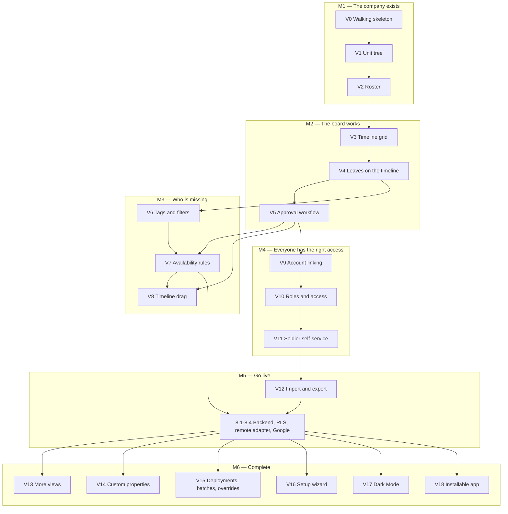

# Sagol — Feature and Dependency Map

The work order of the project (D-075). Each slice takes one feature from the data layer to the
screen, so the owner sees a working product after every slice. Layer separation stays as strict
as it was, enforced by tools rather than by how sessions are divided. Status lives in
`docs/ROADMAP.md`.

## 1. Where we stood at the start (session 0.7)

| Layer | State | Notes |
|-------|-------|-------|
| contracts | complete | Every table, input, repository, command, auth and error type |
| domain | complete | Policy, hierarchy, leaves, accounts, properties, tags, filters, availability |
| config | complete | Env, palette, breakpoints, views, URL, storage, dates |
| data | empty | The next thing every slice needs |
| logic | empty | |
| i18n | empty | |
| ui | empty | `AppRoot` returns null; Tailwind defaults are reset, no tokens yet |
| app | mount only | No env parsing, adapters, providers or router |

`npm run check` is green with 372 tests, and nothing is visible yet. The contracts and domain
already hold most of the hard rules, so slices are mostly wiring, screens and storage.

## 2. Working rules (D-075, D-076)

**One session = one slice. One commit = one layer.**

1. **Order inside a slice:** a model change comes first (`docs` and `contracts` together). After
   that, the order is whatever keeps every commit green, which usually follows the dependencies
   (D-127). Each layer is written against the public API of the one below it.
2. **Every commit passes `npm run check`** and touches one layer. A pre-commit guard
   (`scripts/check-commit-layers.ts`, added in V0) rejects a commit whose `src/` files cross
   layers. `i18n` with `ui` is the one allowed pair (D-025). Files outside `src/` are not a
   layer, so a model change commits `docs` and `contracts` together (iron rule 7).
3. **Boundaries do not change:** `index.ts` only, aliases only, dependency-cruiser as today.
4. **No stubs.** The local adapter grows by slice. Until it is complete, its type is
   `Pick<DataCommands, ...>` and `Pick<DataRepositories, ...>` of what exists, and each `logic`
   module declares the narrow port it needs. Nothing returns "not implemented". When the last
   group lands the adapter `satisfies DataAdapter`, which the remote adapter must also satisfy.
5. **No dead controls.** A control appears only when its action works end to end. The view
   switcher, for example, lists what the engine registry holds, so it grows with the engines.
6. **Permissions are real from V0.** Every read and write goes through the policy from the
   first command. The owner passes because of a real grant (D-006), not a shortcut.
7. **Denial paths are tested before their screens exist.** The shared contract suite takes a
   `seed` port per adapter (local: direct store writes, inside test files only). So "a soldier
   without permission cannot create a unit" is tested in V1, long before the roles screen.
8. **A fix goes in the layer that owns it,** in its own commit in the same slice, if the slice
   needs it. Anything else becomes an open item with a target slice.

**A slice is done when:**

- `npm run check` and `npm run build` are green;
- its demo runs in Playwright, desktop and mobile, RTL, with axe;
- the owner can follow the demo steps in the pull request description in a real browser;
- `OPEN_ITEMS.md` (closed rows moved to its archive), `ROADMAP.md`, the current state in
  `ARCHITECTURE.md` and `Design.md`, and the pull request description are updated (D-043, D-128, D-154);
- the whole Playwright suite ran locally with the CI worker count, the session reviewed its own
  diff read-only, and the pull request merged with CI green (D-110, D-126).

If a slice will not fit one session, split it at a smaller demo and record the split here.

## 3. Dependency graph

**M3 and M4 do not depend on each other.** Either can follow M2, and the owner chooses when M2
is done (OI-031). Both must finish before the backend: V7 because rule enforcement is ported to
the server (OI-029), V11 because real people need linking and roles.

### Why this order

- **Units before soldiers:** a soldier is placed through `unit_memberships`, and the policy
  scopes everything through the unit tree (D-054). The tree is also the simplest content that
  sets the drawer and form patterns (D-024).
- **Soldiers before the timeline:** soldiers are its rows.
- **The grid before the bars:** the grid needs only soldiers, so the real Stone 3 screen shows
  one slice earlier, and V4 only adds bars to it.
- **Linking before roles:** a second person can act only once linked. Roles have no visible
  effect without one, while a linked soldier with no role is a valid, testable state (D-056).
- **Rules after filters:** a rule's population is a `FilterExpression`, and its builder reuses
  the filter UI (D-014). The rule gate itself runs from V4, with no rules defined yet.
- **Backend before completion features (D-082):** IndexedDB lives on one device (D-021). Two
  real people can use the product only on the backend, so M6 comes after go-live.

### What the data layer needs from the first slice

The policy snapshot (`PolicyData`) reads `organizations.baseline_role_id`, `units`, `soldiers`,
`command_ranks`, `seniority_overrides`, `unit_memberships`, `soldier_accounts`, `roles`,
`role_permissions`, `rank_role_bindings` and `access_grants`, on every check. So V0 creates the
full Dexie schema (one version, all tables) and the snapshot loader, even though most of those
tables get commands only in later slices.

### Shared pieces, built once in the first slice that needs them

| Piece | Built in | Reused by |
|-------|----------|-----------|
| Transaction and audit helpers; snapshot loader; change feed | V0 | all |
| Version helper (`expected_version`) | V1, with the first update command | all |
| Shared contract suite with `seed` port | V0 | all, then the remote adapter (8.3) |
| Theme tokens and primitives; `docs/Design.md` | V0, settled in V1 | all UI |
| Error-code to i18n mapping; form issue mapping (OI-024) | V0 | all forms |
| Generic reference commands (create, update, archive, reorder) | V1 | V2, V4, V6, V7, V10, V14, V15 |
| Drawer/sheet and form patterns; panel state in the URL | V1 | all modules |
| Virtualized list | V2 | V5, V9, V13 |
| Engine registry, viewport, view state, floating bars | V3 | V13 |
| Filter encoding in the URL | V3 (unit), V6 (all) | V7, V13 |
| Rule gate in leave commands | V4 | V5, V8, V15 |
| Rule acknowledgment dialog | V7 | V5's forms, V8 |

## 4. Slices

Each card lists what the owner sees, the work per layer, the open items it closes, and the
decisions beyond the baseline. **Baseline for every slice:** D-008, D-017, D-019, D-025, D-036,
D-038, D-044, D-045, D-046, D-068, D-074, D-075, D-076.

### M1 — The company exists

#### V0 — Walking skeleton
**Owner sees:** `npm run dev` → a local sign-in screen in the Stone 3 look → on an empty store,
a form to claim the organization (name, time zone, own name) → the empty workspace: floating
bar with the organization name, user menu, sign-out and the dev identity switcher, and an empty
state. A reload keeps the session. A second local identity sees "no access yet" and no data.
- **tooling:** commit-layer guard; `fake-indexeddb`; Playwright config, first spec, axe, CI job;
  Heebo self-hosted; `.claude/launch.json`.
- **contracts:** `TimeSource`, and `DataAdapterFactory` takes it (D-083).
- **domain:** time-zone check (D-084).
- **data:** Dexie schema; local identity provider; session resolver; helpers; snapshot loader;
  change feed across tabs; `organizations.bootstrapOwner`; `organizations.current`;
  `session.onboardingState`; contract suite and `seed` port.
- **logic:** adapter ports; session service and hooks; query client invalidated by the change
  feed; form issues. The `can` hint moved to V1 (D-085).
- **ui + i18n:** Stone 3 tokens; first primitives; dictionary and error mapping; sign-in,
  onboarding and workspace frame; `docs/Design.md` first version.
- **app:** env parsing; the date adapter (`TimeSource`, D-083); adapter construction; providers;
  router; mount.
- **Open items:** OI-002, OI-003, OI-004, OI-005, OI-006, OI-007, OI-035; OI-021 (a), OI-023 (e),
  OI-024 and OI-033 start here.
- **Decisions:** D-001, D-004, D-005, D-006, D-011, D-021, D-023, D-024, D-026, D-034, D-048,
  D-056, D-059, D-060, D-077, D-079, D-080, D-083, D-084, D-085, D-086.

#### V1 — Unit tree
**Owner sees:** a "Units" drawer (bottom sheet on mobile): create levels and a tree, rename,
reorder, drag to move (a cycle is refused), archive. A deep link reopens the drawer, and two
tabs stay in sync.
- **data:** generic reference commands; `unit_levels`; `units` with `move` and `reorder`; policy
  filter on reads; `color_key` membership; `moveUnitIssues`; `propertyValueIssues`.
- **logic:** reference-data hooks; panel state in the URL; the `can` hint (OI-043, D-085).
- **ui:** drawer/sheet; form pattern; tree module (`@dnd-kit`); palette token pairs;
  `docs/Design.md` settled (D-024).
- **Open items:** OI-011, OI-043; parts of OI-021 (c), OI-023 (b), OI-033.
- **Decisions:** D-009, D-024, D-040, D-053, D-065, D-077, D-085.

#### V2 — Roster
**Owner sees:** a "Soldiers" drawer with a section for ranks (D-094): add a soldier by name, with rank and unit; edit
profile and private fields (מספר אישי); move between units with history kept; archive. Archiving
the last access manager is refused with a clear message.
- **data:** `command_ranks`; `soldiers` (create, update, archive, `updatePrivate`,
  `changeMembership`); `normalizePersonalId`; `membershipOverlapIssues`; `accessManagerIssues`
  after status, archive, rank and membership writes.
- **logic:** soldier view model (rank and unit today, derived).
- **ui:** virtualized list; soldier form; ranks module.
- **Open items:** parts of OI-021 (a, c), OI-023 (b, d: normalization).
- **Decisions:** D-002, D-010, D-018, D-029, D-030, D-054, D-057, D-059, D-065, D-066, D-069, D-094 … D-100.

### M2 — The board works

#### V3 — Timeline grid
**Owner sees:** the main screen: real soldier rows, floating days header, today marked, week
navigation, a unit selector. The window and unit live in the URL, and the back button works. On
a phone the grid scrolls sideways under the bottom bar. No bars yet.
- **logic:** view state (typed search params, date window); rows for a unit on a day (filter
  evaluator).
- **ui:** registry and viewport; timeline core (pure, tested) and view with TanStack Virtual;
  adapter; floating bars; view switcher fed by the registry.
- **Open items:** part of OI-033 (mobile timeline); OI-048, OI-057, OI-058, OI-059 (from A2; OI-059 first, CI is red).
- **Decisions:** D-023, D-054, D-067, D-077.
- **Note:** the mock's view switcher shows four views. Here it lists only the timeline.

#### V4 — Leaves on the timeline
**Owner sees:** a leave types module (color, icon, effect, requires reason); a new-leave button;
the leave appears on the timeline, pending dashed and approved solid, with marker types as an
icon badge. Overlaps get lanes.
- **data:** `leave_type_groups`; `leave_types`; `leaves.create`; `leaves` and `leave_events`
  reads; `planLeaveCreation`; `leaveReasonIssues`; `leaveChangeViolations` and `ruleGate` from
  the first leave command.
- **logic:** leaves by window; create with optimistic update; availability context.
- **ui:** types module; new-leave form; timeline lanes and bars; icon key map.
- **Open items:** OI-013, OI-030; parts of OI-023 (a, b), OI-027, OI-028; OI-051, OI-052, OI-056 (from A2); OI-061 (from V3).
- **Decisions:** D-012, D-013, D-032, D-034, D-041, D-047, D-049, D-063, D-070, D-073.
- **Owner decision at start (OI-030):** what a bar's color means. Stone 3 colors by status, while
  D-032 gives each leave type its own `color_key`.
- **As built:** the type's color with status by form, plus a uniform mode (D-111, D-112); groups in their own section
  (D-113). The availability context of `logic` moved to V6, where the first screen reads a day's status (OI-028).

#### V5 — Approval workflow
**Owner sees:** click a bar → a details drawer: approve, reject, cancel, reopen, edit dates or
type, history, shared and internal comments. An inbox lists what is pending. A stale edit from
another tab gets a clear message.
- **data:** `leaves.transition`, `update`, `reschedule`; `leave_comments`; `updateMyPreferences`.
- **logic:** optimistic updates with rollback on `stale_version`; hints from `LEAVE_PERMISSIONS`.
- **ui:** leave details; inbox; comments; confirm dialogs.
- **Open items:** OI-031; parts of OI-023 (a), OI-024, OI-027.
- **Decisions:** D-013, D-041, D-047, D-049, D-063, D-064.
- **As built:** D-117 to D-122. One edit form sends up to two commands (one command from V7: D-123, OI-076); one thread holds events and comments; the inbox
  has a closed section, which is the way to reopen a leave; the "approve now" default is a switch in the user menu.
  The rule acknowledgment dialog stays with V7 (OI-066). The owner chose M3 after M2 (OI-031).

**End of M2: one commander runs a real leave board. Audit A3 follows, and the owner picks M3 or M4
(OI-031).**

### M3 — Who is missing

#### V6 — Tags and filters
**Owner sees:** tag categories and tags, assigned to soldiers; filter chips in the bar; "only
who is missing"; present and absent counts and lists for a day. Filters stay across views and
in the URL.
- **data:** `tag_categories`; `tags`; `soldiers.setTags`; `tagSelectionIssues`;
  `selectionModeChangeIssues`.
- **logic:** filter state and URL encoding; `partitionAvailability`.
- **ui:** filter bar, chips, present/absent panel.
- **Open items:** OI-012 (the mock's "status" chip is a leave filter, which is that question);
  OI-070, OI-090; OI-078 (asked at the end of the slice), OI-079, OI-082, OI-086, OI-087, OI-089 (from A3).
- **Decisions:** D-015, D-032, D-065, D-067, D-070, D-105, D-125.

#### V7 — Availability rules
**Owner sees:** a rule builder ("at least 2 medics in each platoon"), a heat row on the timeline,
conflicts in the rules module. A leave that breaks a soft rule asks for acknowledgment, and a
hard rule refuses it.
- **data:** `availability_rules`; `filterIssues`, `filterReferences`; what a violation reveals
  about invisible soldiers (OI-075); one edit command (D-123); an archived soldier's leave can only
  be cancelled (D-124).
- **logic:** evaluation for a window; live warnings equal to the command result.
- **ui:** rules module on the shared filter UI; heat row; acknowledgment dialog.
- **Open items:** OI-042 (asked at start); OI-066 (from V5); OI-071, OI-075, OI-091; OI-076, OI-077, OI-083,
  OI-084, OI-085 (from A3).
- **Decisions:** D-014, D-031, D-047, D-067, D-071, D-072, D-073, D-117, D-123, D-124.
- **As built:** D-137 to D-142. The owner kept OI-042 (D-137) and chose that a violation names who is unavailable (D-138).
  The population uses the filter bar's check lists; live warnings run over what the actor reads (OI-094 for V10);
  deployments reach the rule data in V15 (OI-096).

#### V8 — Timeline drag
**Owner sees:** drag to create, move and resize, with live rule and conflict feedback, plus a
touch path on mobile.
- **ui:** drag math in the pure core, tested; interactions through `leaves.create` and `leaves.update`
  (a move or a resize sends the dates, D-123).
- **Open items:** OI-067 (from V5).
- **Decisions:** D-064, D-073, D-123.
- **As built:** D-143, D-144. A move or a resize is one `leaves.update` with the dates; a drag on empty days opens the
  new-leave form with the soldier and the days (`draft` in the URL), since a leave needs a type. On a phone a finger holds
  first, and lanes are taller so every mark is a 44 px target (OI-067). The rule pieces moved to `ui/patterns/rules`.

### M4 — Everyone has the right access

#### V9 — Account linking
**Owner sees:** a second identity asks to link; the owner reviews candidates and approves or
rejects; auto-link works on personal id + verified invite email. The linked soldier sees nothing
until V10 gives them a role, and that is correct.
- **data:** `accounts` commands; `autoLinkSoldier`; `linkCandidates`; `canReviewLinkRequest`;
  `linkEnrichment`.
- **ui:** onboarding request form; review module.
- **Open items:** OI-072, OI-036, OI-034 and OI-019 (asked at start, OI-019 with its schema
  note); OI-026 (decided at start, its own slice if accepted); OI-046; OI-055 (from A2).
- **Decisions:** D-005, D-030, D-066, D-069.
- **As built:** D-148 to D-153. Requests, auto-link, withdrawing and review in the local adapter; the request form, the
  waiting notice and the account-links module; the invite email field. Invite links, revoking and restoring are open items.

#### V10 — Roles and access
**Owner sees:** roles with a permission grid, rank bindings with scope, a baseline role, individual
grants for an acting commander. The identity switcher proves it: a fighter sees their own row, a
squad commander their platoon, and controls follow. Lockout and escalation are refused.
- **data:** `roles`; `role_permissions`; `rank_role_bindings`; `access_grants`; baseline role;
  `accessManagerIssues`; `missingPermissions`; `accessGrantIssues`.
- **logic:** hints across all modules.
- **ui:** roles module; scope picker; grants module.
- **Open items:** OI-068; OI-038, OI-039, OI-040, OI-041 (asked at start); OI-044; OI-047, OI-049, OI-053, OI-054 (from A2); OI-060 (from V3).
- **Decisions:** D-003, D-004, D-028, D-040, D-053 … D-060.

#### V11 — Soldier self-service
**Owner sees:** a fighter on a phone requests a leave, sees status and history, and comments; the
commander approves in the inbox; the fighter sees the result.
- **ui:** my requests and history; mobile-first request flow.
- **Decisions:** D-013, D-023, D-063.

### M5 — Go live

#### V12 — Import and export
**Owner sees:** upload a CSV or JSON, preview a validation report, commit; export the organization.
- **data:** `transfer.importBatch` with `dry_run`; `exportOrganization`.
- **ui:** import/export module.
- **Open items:** OI-018 (restore of history, decided at start); OI-050 (from A2).
- **Decisions:** D-022, D-050.

#### 8.1–8.4 — Backend
Provider decision, migrations, triggers and server functions; RLS and the policy matrix against the
database; remote adapter passing the same contract suite; Google auth, environments and deploy.
- **Open items:** OI-008 (git remote), OI-014, OI-020, OI-022, OI-025, OI-029.
- **Decisions:** D-027, plus the policy, workflow and availability decisions they port.

**End of M5: real people use the product on their own devices. Audit A6 follows.**

### M6 — Complete

From V24 on, every card names its context (D-257): **rotation**, **routine** or **both**. Routine is a real mode, and
its own features come in later slices.

| Slice | Owner sees | Decisions |
|-------|------------|-----------|
| V13 More views | List, table/agenda and calendar engines beside the timeline | D-023, D-026 |
| V14 Custom properties | Definitions module; values in forms and filters | D-016, D-065, D-067 |
| V15 Deployments, batches, overrides | Collective leave, duplicate, deployments and members, seniority overrides | D-012, D-029, D-049, D-071 |
| V16 Setup wizard | Guided first run over the existing forms; progress derived from data | D-033 |
| V17 Dark Mode | Second token set (was row 8.5) | D-024, D-077 |
| V18 Installable app (PWA) | Sagol on the home screen, a worker for the shell only, the update toast, the install item, the offline screen | D-182 … D-185 |
| V22 Daily report (דוח 1) | A day header in every engine opens a centered report: present, absent, leaving and returning, the total, a breakdown by unit in tree order with collapsible names; the active rotation; reasons (off by default, per device, only what the viewer may read); copy as text for a messaging app with a toast; a PNG in the light tokens through the share sheet or a download; a span of days; days outside the scope's rotations are not reportable. Tests: domain categories; e2e for a day tap, counts, the clipboard, the image, a span, reasons with and without permission; axe; phone upright and on its side | D-032, D-070, D-133, D-134, D-161, D-211, D-193 … D-197 |
| V24 Simplification: information architecture | Context: both. Docs only: the term map, the navigation model, five journeys, the rotation as a mode, templates, in `docs/Design.md` | D-212, D-215, D-250 … D-264 |
| V25 Navigation and words | Context: both. Every string by the term map, no "ארגון"; a context pill at the top and a destination pill at the bottom (לוח, שלי, בקשות, דוח 1, ניהול) on every screen; home by permissions, the board or "שלי"; the profile personal only; "ניהול יחידה" grouped, with a line per module and no pins; the requests inbox with the approve-now switch; the role's one primary quick action in the bottom strip ("בקשה חדשה") in place of the floating "+"; the second requests tab and the other duplicates gone. `i18n`, `config` and `ui` only. Tests: journeys (c), (d), (e) on desktop and a phone, axe | D-121, D-173, D-189, D-190, D-250 … D-256, D-263, D-265, D-266 |
| V23 Focus mode | Context: both. A control in the top strip and a key hide both strips and the chips row; one restore button in a corner clear of the name column; Escape restores; the day report still opens from a day. Tests: enter and leave by control, key and Escape, the button's size, axe | D-252, OI-032 |
| V26 Rotation as a mode | Context: both (it defines the two). One rotation at a time by dates (domain rule and exclusion constraint), the mode derived (holding today, nearest upcoming, latest open, שגרה), routine as a real mode with its notice and "פתיחת סבב" as the quick action, the explicit and reversible close by the creator or who may manage rotations, a new rotation from a previous one, the whole unit unless a list is chosen, a tag's lifetime per assignment with the category's default, `pinned_modules` dropped. Model change first. Tests: domain rules, the constraint against the database, journey (b) | D-019, D-179, D-188, D-211, D-257 … D-260, D-263 |
| V27 Templates and setup | Context: routine (the setup lands in routine). The claim creates the root unit with the organization; the "פלוגה" template in config and i18n, applied through the commands; pick, adjust, done, into routine mode; the time zone in the root unit's form; `pinned_modules` dropped (model change first); quick entry of several soldiers in a grid, through `soldiers.create` per row; approving several join requests, each through its own link review. Tests: the template's command sequence, the grid's paste and per-row result, the bulk approval's per-row result, journey (a) | D-005, D-033, D-180, D-251, D-261, D-262, D-263, D-282, D-283 |
| V28 Several requests at once | Context: a rotation. One sheet of rows (dates, type, reason), add a row, a recurring row that expands at submit and is not stored; sent atomically through a new `createLeaves` command, each row its own leave; the quick action fitted to the mode (OI-219); the one-time install offer after sign-in (OI-223). Tests: the expansion, the atomic send, journey (c) with several rows | D-049, D-076, D-266, D-267, D-274 |
| V29 Board visual language | Context: both. Presence quiet, absence a hole (dimmed or hatched, the type's color as an edge or icon); green never means away; pending distinct from approved; rounds (leaves in a batch) as a background layer under requests; the opening view by device (OI-220); a rule's breach in every view (OI-221). Tests: the derived kind, contrast in both themes, the opening view on desktop and a phone, axe | D-019, D-108, D-174, D-179, D-268, D-272 |
| V30 דוח 1 as a workflow | Context: both. Each unit's commander confirms its list for a date; the rotation's report owner sees per-unit status (confirmed, not yet, changed since) and copies one consolidated message; only the confirmation fact and the report owner are stored (schema change). Tests: "changed since" derived, journey (e) with confirmations | D-019, D-193, D-269 |
| V31 Leave-round planner | Context: a rotation. Generate the routine rhythm (for example 8 in, 6 home) for groups of soldiers; ordinary leaves in a batch, rounds on the board. Tests: the generated dates, the batch | D-179, D-268, D-270 |

From M6 on, each slice also updates the remote adapter and server functions, and the contract
suite holds both to the same behavior (D-082). Open items: V13 OI-088; V14 OI-037, OI-073, OI-080;
V15 OI-069, OI-074, OI-081.

Focus mode (the mock's "מצב מיקוד", OI-032) is V23, after V25 gives it the two strips to hide (D-252, D-264).
Open items: V25 OI-200 … OI-206 and OI-218; V26 OI-207 … OI-211 and OI-217; V27 OI-212 … OI-215, OI-225 and OI-233 … OI-235; V22 OI-216;
V28 OI-219 and OI-223; V29 OI-220, OI-221.

## 5. Audits (D-078)

| Audit | When | Covers |
|-------|------|--------|
| A1 | done, `.claude/archive/docs/audits/A1.md` | Contracts and domain against the decisions |
| A2 | done, `.claude/archive/docs/audits/A2.md` | Server-authoritative behavior, no bypasses, first UI and Design.md |
| A3 | done, `.claude/archive/docs/audits/A3.md` | Leave workflow, timeline engine, view state |
| A4 | done, `.claude/archive/docs/audits/A4.md` | Filters and rules: UI warnings equal command results |
| A5 | after M4 | Permissions end to end |
| A6 | after M5 | Production readiness, RLS against the policy matrix |
| A7 | after M6 | Whole product |

A8 is retired. Audits stay separate and read-only, and accepted findings become open items with a
target slice.

## 6. Design input: Stone 3 (D-077)

Source: canvas "סגול — וריאציות מראה", artboard "אבן 3" (`project/Stone3.dc.html`), at
<https://claude.ai/artifact/QxPHzP8EKeSiUbduUvdvnD>, not final. It is a direction: V0 turns it into
tokens and `docs/Design.md`, and real screens may refine it.

| Token (semantic) | Value | Mock's name |
|------------------|-------|-------------|
| `--color-canvas` | `#EDECE8` | רקע |
| `--color-surface` | `#FAF9F6` | משטח |
| `--color-line` | `#E7E5DF` | קו |
| `--color-text` | `#1A1A18` | טקסט |
| `--color-text-muted` | `#5F5D57` | טקסט משני |
| `--color-action` | `rgba(16,19,24,.70)`, solid `#1A1E25` | פעולה |
| `--color-on-action` | `#F4F6F8` | |
| `--color-status-approved` | `#3F7A5D` | מאושר |
| `--color-status-pending` | `#B7791F`, fill at 8%, dashed | ממתין |
| `--color-status-rejected` | `#A8382D` | נדחה |
| `--color-marker` | `#5B45C4`, ink `#4A36B8` | סימון |
| `--color-today` | `#2A2A26`, band `rgba(26,26,24,.035)` | |

- **Glass:** white at 50–60% with blur 14–20 and `saturate(180%)` for bars, chips and cards; dark glass
  for the primary action. Solid fallbacks under `prefers-reduced-transparency` (the mock's
  `reduceTransparency`).
- **Type:** Heebo 400–700; 24 title, 15 body, 13 soldier name, 12.5 controls, 11.5 and 11 labels; tabular
  digits.
- **Shape:** bars 6, panels 16, pills 15–20, sheet 24. Rows 36, name column 124, day column 64, as
  density tokens.
- **Form carries status:** solid approved, dashed pending, round icon badge for a marker. The badge
  maps cleanly to an effective effect of `available` (D-012, D-032).

Things the mock leaves open, to settle while building (OI-030, OI-033):

- **Pending as text:** `#B7791F` on the surface is about 3.5:1, fine for a dashed border, below 4.5:1
  for text. It needs a darker text variant.
- **Touch targets:** controls are 30 px and the chip's remove button 22 px. Mobile needs 44 px.
- **Not shown:** drawer/sheet, forms, the mobile layout and the 12 palette keys. V1 and V3 design them
  in the same language.
- **Bar color:** see the V4 decision.

## 7. Replaced roadmap rows

Rows 8.1 to 8.4 keep their ids. The others moved here:

| Old rows | Now in |
|----------|--------|
| 2.1, 2.2, 2.3 (data) | Split across V0–V12; the contract suite grows with each slice |
| 3.1 | V0 |
| 3.2 | V1, V2, V4, V6 |
| 3.3 | V3, V4, V6 |
| 4.1, 4.2 | V0, V1 |
| 4.3 | V0 (sign-in, frame, empty states), V9 (onboarding request), V3 (navigation) |
| 4.4 | V1, V2 (levels, ranks), V10 (roles, grants) |
| 4.5 | V4, V6, V14 |
| 4.6 | V12 |
| 4.7 | V16 |
| 5.1 | V2, V6, V9 |
| 5.2 | V5, V11 |
| 5.3 | V5, V7 |
| 6.1, 6.3, 6.4 | V3, V4 |
| 6.2, 6.6 | V13 |
| 6.5 | V8 |
| 7.1, 7.2, 7.3 | V7 |
| 8.5 | V17 |

## 8. Risks

- **First-session size.** V0 lays rails in every layer, roughly 2,000 lines. If it will not fit,
  split it at "sign in and see the empty frame" before the bootstrap form.
- **A missed decision.** Sessions now read part of `DECISIONS.md` (D-081). The cards list what each
  slice needs, and an audit reads everything. A card found to be missing an entry gets fixed here.
- **One device until M5.** Everything before the backend is one browser. The identity switcher
  simulates other people on that device, but it is not real multi-user use.
- **Late backend port.** M5 ports twelve slices of rules to SQL at once. The shared contract suite and
  policy matrix exist to contain that, and M3 and M4 add to it.
